# Circuit Game Review & Implementation Plan

> [!NOTE]
> **Review Scope & Model Identification**
> - **Evaluator Model**: Gemini 3.8 Flash (High)
> - **Scope**: Static code, asset, and audit inspection of Circuit (Game 13 of 32 Daily + Bonus). Read-only review; no runtime execution, mutation, network calls, or current-board solution disclosure.
> - **Visuals Inspected**: `before-390.png` (390px mobile viewport) and `before-help.png` (help overlay dialog).

---

## 1. Verified Logic vs. Hypotheses

### Verified Logic (Audit & Code Inspection Backed)
- **Board & Layout Integrity**: Exactly 286 unique letter layouts and 44,957 valid word entries.
- **Published Pars**: Exactly 56 par 2 puzzles and 230 par 3 puzzles.
- **Minimal Bounds Verified**: Shorter than published = 0. Exhaustive single/pair lower bounds prove no puzzle can be solved in fewer words than its published par.
- **Canonical Vocabulary**: Exactly 598 canonical solution words across all 286 layouts; 100% (598/598) reside within the supplied common list (0 outside).
- **Calendar Uniqueness**: 182 dated daily selections uniquely map to 182 distinct puzzle layouts.
- **Supplemental Editorial Words**: `withReviewedWords()` in `engine.ts` programmatically injects valid common words (such as `"plum"`) omitted from legacy frequency dictionaries without altering puzzle validity.
- **Unconfirmed Destructive Actions**:
  - `actions.hint()` immediately burns the single free clue and prints the solution words without confirmation.
  - `actions.giveUp()` forfeits the puzzle and resets the daily streak to 0 with zero confirmation.
  - `actions.restartChain()` immediately wipes all played words with zero confirmation.
- **Reload Side-Effects (Wins Restore)**: `CircuitPage.tsx` unconditionally triggers `fireConfetti()` and `useGameOverlays` auto-popups the win modal after 900ms on every page load or revisit of an already-finished puzzle.
- **Live Date Bug**: `CircuitPage.tsx` renders `dateLabel()` (evaluating `new Date()` Chicago time) rather than the frozen date corresponding to `state.dayNumber`.
- **Practice Immediate Repeat**: `startPractice()` in `useCircuit.ts` passes `cur.puzzleNo - 1` only when `cur.mode === 'daily'`, but passes `-1` when already in `'practice'`, allowing the identical practice board to repeat immediately.
- **Sharing Deficiencies**:
  - `buildCircuitShare()` outputs static orange and purple emoji squares (`🟧🟧🟧🟩🟩🟩🟦🟦🟦🟪🟪🟪` or `⬛` x12), ignoring actual letter coverage and hint usage.
  - `CircuitWinModal.tsx` provides no Practice mode sharing.
  - No PNG card generation (portrait or square) exists for Circuit.
  - `copyText()` in `CircuitWinModal.tsx` ignores copy rejection and sets `copied = true` unconditionally.
- **Total Absence of Physical Keyboard Input**: Neither `CircuitBoard.tsx` nor `CircuitPage.tsx` listens for keyboard events; desktop and external iPad keyboards cannot input letters, backspace, or submit.

### Hypotheses & Design Assessments
- **Palette Friction (Brown & Purple)**: In `before-390.png`, Arc 1 uses terracotta brown (`#a65d37`) and Arc 4 uses purple (`#8a587a`). Shifting to cool blue, teal, cyan, and slate identities will directly align with user aesthetic preferences while maintaining 4 distinct arc contrasts.
- **Dial Readout Word Wrapping**: On mobile viewports (390px), `.circuit-readout>div:first-child` restricts text to `max-width: 46%` with `overflow-wrap: anywhere`. Longer words (6–8 letters such as "BOUGHT" or "BRIDGES") wrap mid-word onto two lines inside the dial center. Widening the container to 65% and adding dynamic font sizing (`text-lg` / `text-xl`) will ensure words display on a single line.
- **Help Modal Contradiction**: `before-help.png` asserts "The chain is seeded for you", but on an empty board, the instruction reads "Start with any letter." Correcting this copy will eliminate initial player confusion.
- **Arc Subscript Badges**: In `before-390.png`, the numerical arc badges (`1`, `2`, `3`, `4`) are 9px subscripts placed in the lower-right corner of the node. Enlarging and emphasizing these badges ensures accessibility for users with color vision deficiency.

---

## 2. Defect Triage

### Critical Defects
1. **[C1] Unconfirmed Irreversible Game Forfeiture ("Reveal route")**
   - **Trigger**: Tapping the "Reveal route" flag button in `CircuitBoard.tsx`.
   - **Root Cause**: `actions.giveUp()` in `useCircuit.ts` lines 305–310 immediately marks the game as gave up, ends the puzzle, and wipes the daily streak (`currentStreak: 0`) without confirmation.
   - **Impact**: Accidental tap permanently ruins a player's daily puzzle streak with no undo or confirmation.
2. **[C2] Unconfirmed Instant Chain Wipeout ("Restart chain")**
   - **Trigger**: Tapping the "Restart chain" button placed adjacent to "Undo word".
   - **Root Cause**: `actions.restartChain()` in `useCircuit.ts` lines 248–253 wipes `played` and `current` words immediately without confirmation.
   - **Impact**: Accidental touch on mobile erases all completed words in a session.
3. **[C3] Unconfirmed Free Hint Consumption ("Route clue")**
   - **Trigger**: Tapping "Route clue · 1 free".
   - **Root Cause**: `actions.hint()` in `useCircuit.ts` lines 288–303 immediately consumes the round's single free clue, logs `hintsUsed: 1`, and exposes the solution words in toast and readout without confirmation.
   - **Impact**: Irreversible loss of lifeline from an accidental tap.

### Important Defects
1. **[I1] Automatic Results Popup & Confetti Explosion on Every Reload**
   - **Trigger**: Refreshing or revisiting an already completed daily game.
   - **Root Cause**: In `CircuitPage.tsx`, `useGameOverlays` triggers modal popup after 900ms when `state.finished` is true, and `useEffect` unconditionally invokes `fireConfetti()`.
   - **Impact**: Intrusive layout shift, modal covers the board upon page load, and loss of emotional reward.
2. **[I2] Total Lack of Physical Keyboard Input**
   - **Trigger**: Typing on a desktop keyboard or iPad Smart/Magic Keyboard.
   - **Root Cause**: No `keydown` listener exists in `CircuitBoard.tsx` or `CircuitPage.tsx`. Virtual buttons also retain DOM focus, which triggers `isNativeEnter()` to swallow Enter key presses.
   - **Impact**: The game cannot be played using physical keys.
3. **[I3] Immediate Practice Mode Puzzle Repeat**
   - **Trigger**: Completing or restarting a practice round and tapping "New practice round".
   - **Root Cause**: In `useCircuit.ts` line 314, `practiceCircuit(cur.mode === 'daily' ? cur.puzzleNo - 1 : -1)` passes `-1` when in practice mode, leaving `excludeIndices` empty.
   - **Impact**: Players frequently receive the exact puzzle they just finished.
4. **[I4] Dishonest & Incomplete Sharing Suite**
   - **Trigger**: Clicking "Share result" in `CircuitWinModal.tsx` or attempting to share from Practice mode.
   - **Root Cause**: `buildCircuitShare` outputs hardcoded emoji squares (`🟧🟧🟧🟩🟩🟩🟦🟦🟦🟪🟪🟪`) that do not reflect actual letters lit or hints used; no Practice sharing button; no PNG image cards; `copyText` fails silently while reporting success.
   - **Impact**: Misleading share cards, zero image sharing support, and silent clipboard failures.

### Minor Defects
1. **[M1] Disliked Brown & Purple Palette**
   - **Trigger**: Viewing the game board and ring nodes.
   - **Root Cause**: Hardcoded `#a65d37` (brown) and `#8a587a` (purple) in `CircuitBoard.tsx` and `engine.ts`.
   - **Impact**: Violates operator visual preference.
2. **[M2] Dial Readout Mid-Word Line Breaks for Long Words**
   - **Trigger**: Typing or playing 6–8 letter words on a mobile viewport.
   - **Root Cause**: `.circuit-readout>div:first-child` has `max-width: 46%` and `overflow-wrap: anywhere`.
   - **Impact**: Breaks words like "BOUGHT" into two awkward lines in the center of the ring.
3. **[M3] Help Modal Seed Misconception**
   - **Trigger**: Opening the "How to play CIRCUIT" dialog.
   - **Root Cause**: Text claims "The chain is seeded for you", contradicting the empty initial board.
   - **Impact**: Player confusion during onboarding.
4. **[M4] Live Date Subtitle on Past Puzzles**
   - **Trigger**: Viewing an archived or previously played puzzle.
   - **Root Cause**: Header renders `dateLabel()` (current date) rather than the puzzle's calendar date.
   - **Impact**: Inaccurate historical records.

---

## 3. 5 Highest-Value Improvements

```mermaid
flowchart TD
    A["1. Safe Action Confirmations"] --> A1["Modal confirmation for Route Clue"]
    A --> A2["Modal confirmation for Reveal Route / Surrender"]
    A --> A3["Modal confirmation for Restart Chain"]

    B["2. Cool Blue/Teal Visual Refresh"] --> B1["Eliminate Brown & Purple Tokens"]
    B --> B2["Adopt 4 Cool Teal/Cyan/Slate/Indigo Arcs"]
    B --> B3["Widen Readout & Scale Fonts (No Mid-Word Wrap)"]

    C["3. Complete Multi-Format Sharing"] --> C1["Portrait (9:16) & Square (1:1) PNG Cards"]
    C --> C2["Honest Coverage, Hints & Par Telemetry"]
    C --> C3["Practice Mode Share & Truthful Clipboard Fallback"]

    D["4. Fluid Physical Keyboard Controls"] --> D1["Global A-Z, Backspace, Enter, Esc Handling"]
    D --> D2["Arc-Aware Multi-Instance Letter Resolution"]
    D --> D3["Blur On-Screen Buttons to Prevent isNativeEnter Swallowing"]

    E["5. Session & Reload Hygiene"] --> E1["Ephemeral freshFinish Flag (Silent Reload)"]
    E --> E2["Frozen Daily Date in Subtitle and Modals"]
    E --> E3["Exclude Current Puzzle in Practice Mode"]
```



1. **Safe Action Confirmations (Hint, Restart, Surrender)**:
   - Introduce lightweight confirmation dialogs before executing "Route clue", "Restart chain", and "Reveal route". Prevents accidental tap forfeits and lifeline burns.
2. **Cool Blue/Teal Aesthetic & Readout Typography**:
   - Retire brown (`#a65d37`) and purple (`#8a587a`) in favor of four accessible cool tones: Deep Teal (`#1e7e78`), Sky Cyan (`#248ac2`), Steel Slate (`#4a6fa5`), and Cool Indigo (`#3a54b4`).
   - Widen the dial readout container to 65% and dynamically scale font size for 6+ letter words so they remain on a single line.
3. **Comprehensive Multi-Format Honest Sharing Suite**:
   - Client-side Canvas generator producing Portrait (`1080x1920`) and Square (`1080x1080`) PNG cards.
   - Honest representation: distinguishes Daily vs. Practice, displays frozen puzzle date, exact words used, published par, hints used count, and abstract 12-letter arc coverage without spoiling solution words or letters.
   - Support Practice mode sharing and verify clipboard write success with manual fallback.
4. **Fluid Physical Keyboard Controls & Input Hardening**:
   - Support physical typing on desktop and iPad keyboards (A–Z letter selection, Backspace, Enter submission, Escape).
   - If a typed letter exists on multiple arcs, intelligently select the valid letter complying with the arc hop rule.
   - Blur virtual buttons after tap to prevent `isNativeEnter` from swallowing physical Enter.
5. **Session, Reload, and Practice Flow Hygiene**:
   - Add ephemeral `freshFinish` state so confetti and auto-win modals trigger only on a fresh interactive win.
   - On reload of a finished puzzle: silently restore board with a clean "See results" button.
   - Pass `cur.puzzleNo - 1` in Practice mode to guarantee consecutive practice puzzles are distinct.
   - Render frozen puzzle date from `state.dayNumber`.

---

## 4. Risks & Mitigations

| Risk | Description | Mitigation |
| :--- | :--- | :--- |
| **Dictionary & Puzzle Corruption** | Modifying word lists or engine rules could invalidate the 286 puzzles or violate verified pars. | Do not alter `puzzles.json` or core arc/hop rules. Preserve exact puzzle data and word validation logic. |
| **Save State Incompatibility** | Introducing new confirmation or session flags could break historical localStorage records. | Keep `freshFinish` and modal confirmation open states strictly in React memory state; preserve `restoreCircuitProgress()` validation schema. |
| **Duplicate Letter Disambiguation** | If a typed letter matches multiple positions on the ring, an arbitrary pick could violate the arc rule. | On key press, evaluate all matching letter indices and pick the one whose arc differs from the previous letter's arc. |
| **Canvas Export Taint on Mobile WebKit** | Offscreen canvas rendering can fail or taint on iOS Safari if external web fonts fail to load. | Use standard preloaded font stacks (`DM Sans`, sans-serif) and native 2D canvas drawing paths with no external image dependencies. |
| **DailySession Race Condition** | Confirming a hint or restarting across multiple open tabs could race with storage sync. | Route all gameplay state changes through `dailySession.commit()` and maintain local UI flags. |

---

## 5. Subjective Predictions (Gemini 3.8 Flash Predictions)

> [!IMPORTANT]
> The following 1–5 scores are model predictions reflecting game design and code analysis, **not** measured user ratings or operator scores.

- **Fun**: `3.5 / 5`
  - *Current*: Intellectually compelling topological word deduction, but spoiled by unconfirmed hint burns, accidental forfeits, and missing keyboard input.
  - *Potential*: `4.6 / 5` with fluid keyboard play, safe action prompts, and clean word displays.
- **Clarity**: `3.2 / 5`
  - *Current*: Help modal misleads regarding initial seed; tiny 9px arc numbers; hint mechanics lack explanation.
  - *Potential*: `4.7 / 5` with corrected instructions, prominent arc badges, and explicit confirmation dialogs.
- **UI / Visual**: `2.8 / 5` *(Directly inspected from phone images `before-390.png` and `before-help.png`)*
  - *Current*: Disliked brown/purple palette, cramped 48px ring nodes, and mid-word line breaking in readout.
  - *Potential*: `4.6 / 5` with crisp teal/cyan/slate aesthetic, spacious typography, and polished tactile buttons.
- **Replayability**: `4.2 / 5`
  - *Current*: 286 unique layouts and 182 dated daily selections provide solid depth, though Practice mode can immediately repeat.
  - *Potential*: `4.8 / 5` with guaranteed non-repeating practice puzzles and streak tracking.
- **Shareability**: `2.0 / 5`
  - *Current*: Deceptive orange/purple emoji blocks, no PNG export, no Practice share, unverified clipboard copy.
  - *Potential*: `4.7 / 5` with dual-format PNG cards, honest par/hint telemetry, and native share sheet integration.

---

## 6. Implementation Plan & Proposed Changes

### Component 1: Engine & Share Telemetry (`packages/kimi-pebbles/src/games/circuit/`)

#### [MODIFY] `packages/kimi-pebbles/src/games/circuit/engine.ts`
- Replace brown/purple palette with cool teal/cyan/slate/indigo tokens:
  ```ts
  export const ARC_COLORS = ['#1e7e78', '#248ac2', '#4a6fa5', '#3a54b4']
  export const ARC_EDGES = ['#145551', '#1a6189', '#334e75', '#273a7d']
  ```
- Refactor `buildCircuitShare` to produce honest, spoiler-free text:
  ```ts
  export function buildCircuitShare(
    puzzleNo: number,
    wordsUsed: number,
    par: number,
    gaveUp: boolean,
    hintsUsed: number,
    mode: 'daily' | 'practice',
    dateText?: string
  ): string {
    const medal = medalForChain(wordsUsed, par, gaveUp)
    const header = mode === 'daily'
      ? `CIRCUIT No. ${puzzleNo}${dateText ? ` · ${dateText}` : ''}`
      : `CIRCUIT Practice`
    const hintLabel = hintsUsed === 0 ? 'No hints' : `${hintsUsed} hint${hintsUsed > 1 ? 's' : ''}`
    const resultLine = gaveUp
      ? `${medal.icon} Route revealed · par ${par}`
      : `${medal.icon} ${wordsUsed} word${wordsUsed === 1 ? '' : 's'} · par ${par} · ${hintLabel}`
    const dots = gaveUp ? '⚪'.repeat(12) : '🟢'.repeat(12)
    return `${header}\n${resultLine}\n${dots}`
  }
  ```

---

### Component 2: State & Session Hygiene (`packages/kimi-pebbles/src/games/circuit/`)

#### [MODIFY] `packages/kimi-pebbles/src/games/circuit/useCircuit.ts`
- Add ephemeral `freshFinish: boolean` to `CircuitState` (defaults to `false`, set to `true` only when `finish()` is invoked during active play).
- Ensure `startPractice()` passes the current puzzle index to prevent immediate repeats:
  ```ts
  const startPractice = useCallback(() => {
    const cur = ref.current
    const { puzzle, puzzleNo } = practiceCircuit(cur.puzzleNo - 1)
    setS(prev => ({
      ...prev,
      mode: 'practice',
      phase: 'playing',
      puzzle,
      puzzleNo,
      played: [],
      current: [],
      revealed: 0,
      hintsUsed: 0,
      finished: false,
      gaveUp: false,
      freshFinish: false,
      toast: null,
      shaking: false,
    }))
  }, [])
  ```
- Expose safe execution functions or confirmation states for `hint`, `restartChain`, and `giveUp`.

---

### Component 3: Board & Keyboard Controls (`packages/kimi-pebbles/src/games/circuit/`)

#### [MODIFY] `packages/kimi-pebbles/src/games/circuit/CircuitBoard.tsx`
- Replace internal `ARC_COLORS` and `ARC_EDGES` constants with the cool teal/cyan/slate/indigo palette.
- Widen readout container from `max-w-44` / `max-width: 46%` to `max-w-64` / `65%` and apply dynamic text sizing:
  ```tsx
  <div className={cn(
    "font-display font-extrabold uppercase tracking-[0.15em]",
    currentWord.length > 5 ? "text-lg sm:text-xl" : "text-2xl sm:text-3xl"
  )}>
    {currentWord || (needStart ? `${needStart}…` : ' ')}
  </div>
  ```
- Blur virtual buttons on click to ensure subsequent physical Enter key presses are not swallowed by `isNativeEnter()`.
- Add confirmation dialog states for Route Clue, Restart Chain, and Reveal Route.

#### [MODIFY] `packages/kimi-pebbles/src/games/circuit/CircuitPage.tsx`
- Guard `fireConfetti()` and initial modal opening with `state.freshFinish === true`:
  ```tsx
  useEffect(() => {
    if (state.freshFinish && !state.gaveUp) fireConfetti()
  }, [state.freshFinish, state.gaveUp])
  ```
- Render frozen puzzle date corresponding to `state.dayNumber`:
  ```tsx
  subtitle={state.mode === 'daily' ? `No. ${state.puzzleNo} · ${dayNumberToDate(state.dayNumber)}` : 'Practice round'}
  ```
- Attach global `keydown` event listener:
  ```ts
  useEffect(() => {
    if (state.phase !== 'playing' || !state.puzzle) return
    const onKeyDown = (e: KeyboardEvent) => {
      if (e.target instanceof HTMLInputElement || e.target instanceof HTMLTextAreaElement) return
      if (e.key === 'Backspace') { e.preventDefault(); actions.backspace(); return }
      if (e.key === 'Enter') { e.preventDefault(); actions.submit(); return }
      if (e.key === 'Escape') { e.preventDefault(); actions.clearWord(); return }
      if (/^[a-zA-Z]$/.test(e.key)) {
        e.preventDefault()
        const char = e.key.toLowerCase()
        const matchIndices = [...state.puzzle!.l]
          .map((c, i) => (c === char ? i : -1))
          .filter(i => i >= 0)
        // Pick the index that complies with the arc hop rule
        const lastArc = state.current.length > 0 ? arcOf(state.current[state.current.length - 1]) : null
        const validIndex = matchIndices.find(idx => lastArc === null || arcOf(idx) !== lastArc)
        if (validIndex !== undefined) actions.tapLetter(validIndex)
      }
    }
    window.addEventListener('keydown', onKeyDown)
    return () => window.removeEventListener('keydown', onKeyDown)
  }, [state.phase, state.puzzle, state.current, actions])
  ```

---

### Component 4: Dialogs & Sharing (`packages/kimi-pebbles/src/games/circuit/`)

#### [MODIFY] `packages/kimi-pebbles/src/games/circuit/CircuitHelpModal.tsx`
- Correct bullet 2 to remove the false claim that the chain is seeded initially:
  - "Start with any letter. For subsequent words, each word must start with the last letter of the previous one."

#### [MODIFY] `packages/kimi-pebbles/src/games/circuit/CircuitWinModal.tsx`
- Implement Portrait (`1080x1920`) and Square (`1080x1080`) Canvas PNG card generation (clean abstract arc track graphic, words used vs par, hints count, frozen date, no secret words or letters).
- Add "Share result" button to Practice mode.
- Integrate native `navigator.share` with truthful clipboard copy fallback.

---

### Component 5: CSS & Styling (`packages/kimi-pebbles/src/index.css`)

#### [MODIFY] `packages/kimi-pebbles/src/index.css`
- Update `html[data-game-id='kimi-circuit']` theme tokens:
  ```css
  html[data-game-id='kimi-circuit'] {
    --identity: #1e7e78;
    --identity-hsl: 176 61% 31%;
    --identity-soft: #e2f2f0;
    --identity-dark: #145551;
    --slot-edge: 176 61% 20%;
    --grape-edge: 176 61% 20%;
  }
  ```
- Remove `overflow-wrap: anywhere` from `.circuit-readout>div:first-child` and increase max-width to 65%.
- Add `.circuit-share-panel` and `.circuit-share-formats` styling matching Cairn/Morph/Tangle.

---

## 7. Verification Plan

### Automated Tests
- **Par & Board Invariance**: Verify all 286 puzzles in `puzzles.json` match audit specs (56 par 2, 230 par 3).
- **Common List Solution Coverage**: Verify 598 canonical words remain 100% within the common word list.
- **Practice Exclusion Test**: Verify that calling `practiceCircuit(N)` never returns puzzle index `N`.
- **Save Schema Backward Compatibility**: Validate that legacy `CircuitProgress` objects load safely without data loss.

### Manual Verification
- **Keyboard Play**: Type a complete valid word on physical keyboard, press Enter to submit, press Backspace to delete a letter. Verify smooth input with no focus swallowing.
- **Safety Prompts**:
  - Tap "Route clue · 1 free" -> verify confirmation dialog opens; cancel -> verify clue is not consumed; confirm -> verify clue displays.
  - Tap "Reveal route" -> verify confirmation dialog opens; cancel -> verify puzzle continues; confirm -> verify route revealed.
  - Tap "Restart chain" -> verify confirmation dialog opens; cancel -> verify chain is intact.
- **Silent Reload**: Complete a puzzle, verify confetti fires once. Reload the page -> verify confetti does NOT fire, modal does NOT auto-popup, and board is cleanly visible with "See results" button.
- **Visual & Layout Inspection**: Open on 390px mobile viewport; verify no brown/purple colors, verify 6–8 letter words fit without mid-word breaks in the dial readout, and verify arc numbers are sharp and legible.
- **Sharing Inspection**: Generate and download Portrait and Square PNG cards; verify truthful text copy, verify Practice mode share works, and confirm no solutions or URLs are leaked.
