# Hunch Game Review & Implementation Plan

> [!NOTE]
> **Review Scope & Model Identification**
> - **Evaluator Model**: Gemini 3.8 Flash (High)
> - **Scope**: Static code, asset, and audit inspection of Hunch (Game 12 of 32 Daily + Bonus). Read-only review; no runtime execution, mutation, or answer leakage.
> - **Visuals Inspected**: `before-390.png` (390px mobile viewport) and `before-help.png` (help overlay dialog).

---

## 1. Verified Logic vs. Hypotheses

### Verified Logic (Command & Audit Backed)
- **Answer Bank Integrity**: Exactly 937 unique 5-letter answers. Validated 100% dictionary coverage (937/937) against existing dictionary and 100% common-list membership.
- **Selector Days**: 182 calendar days uniquely mapped to distinct answers.
- **Evaluation Accuracy**: 59,049 exhaustive pair comparisons verified against an independent letter-quota evaluation oracle. Two-pass duplicate letter logic correctly evaluates greens first, then yellow/absent.
- **Accepted Guess Vocabulary**: Existing Cairn dictionary covers 15,921 five-letter words. Pinned expansion (English + Wordnik + ENABLE + 6 Zynga examples) yields 17,946 valid guesses (+2,025 words), guaranteeing coverage of all 937 answers.
- **Save/Restore Resilience**: `restoreHunchProgress` sanitizes input types, validates word lengths, and safely loads historical saves containing duplicate guesses without crashing.
- **Input Interception Bug**: `isNativeEnter()` checks `event.target?.closest(...)`; clicking any virtual keyboard button focuses that DOM element, causing subsequent physical Enter presses to be intercepted and swallowed.
- **Repeat Guess Penalty**: `useHunch.submit()` does not check `prev.guesses.includes(guess)`, consuming an attempt when submitting a previously guessed word.
- **Reload Side-Effects**: `HunchPage` fires `fireConfetti()` and triggers `useGameOverlays` win popup unconditionally on every reload of a finished puzzle.
- **Sharing Gaps**: Unverified clipboard copy, no PNG generation (portrait or square), no Practice mode share, and no frozen played date in share text.

### Hypotheses & Design Assessments
- **Theme Fatigue**: The mustard/brown palette (`#94701c`, `#eee7d0`, `#cbbd94`) feels muddy and dated; transitioning to a modern blue/teal aesthetic with crisp neutral backgrounds will substantially improve visual satisfaction.
- **Key Hit Targets & Typography**: 16px key typography and 10px Enter key labels on mobile (390px width) induce mis-taps and visual squint; bumping sizes to 18–20px will improve ergonomics.
- **Rule Misconceptions**: Players frequently misunderstand duplicate letter evaluation; adding an interactive example demonstrating green vs. gray duplicate letters will eliminate player frustration.
- **Lifeline Intentionality**: A confirmation dialog for the single letter hint prevents accidental burns, while highlighting the revealed letter on the on-screen keyboard connects the hint directly to gameplay.

---

## 2. Defect Triage

### Critical Defects
1. **[C1] Physical Enter Key Swallowed After Virtual Key Interaction**
   - **Trigger**: Click any virtual keyboard key, backspace, or hint button, then press physical Enter.
   - **Root Cause**: `isNativeEnter()` returns `true` because `event.target` is focused on an in-board button, aborting `onKey` submission.
   - **Impact**: Breaks physical keyboard play on desktop and iPad with keyboard attachment.
2. **[C2] Repeat Guess Costs an Attempt**
   - **Trigger**: Submitting a word previously entered during the same puzzle session.
   - **Root Cause**: `submit()` in `useHunch.ts` does not check `prev.guesses.includes(guess)` before recording the guess and decrementing remaining attempts.
   - **Impact**: Accidental resubmissions severely penalize the player.

### Important Defects
1. **[I1] Automatic Results Popup & Win Confetti on Every Reload**
   - **Trigger**: Refreshing or revisiting an already completed daily game.
   - **Root Cause**: `useGameOverlays` triggers modal popup after 900ms when `state.finished` is true; `useEffect` unconditionally invokes `fireConfetti()`.
   - **Impact**: Clutters the UI, causes layout shifts, and diminishes the emotional reward of earning confetti.
2. **[I2] Unconfirmed & Disconnected Hint Activation**
   - **Trigger**: Tapping "Reveal a letter" button.
   - **Root Cause**: Immediately burns the round's single free hint with zero confirmation; reveals letter membership only via toast/header text; does not illuminate the letter on the keyboard.
   - **Impact**: Irreversible accidental taps; poor player mental mapping.
3. **[I3] Unverified Clipboard Copy & Absent Practice/PNG Sharing**
   - **Trigger**: Clicking "Share result" in `HunchWinModal` (or playing Practice mode).
   - **Root Cause**: `copyText` failure is ignored while setting `copied = true`; no canvas/PNG export; no share option in Practice mode.
   - **Impact**: Deceptive UI feedback; inability to share practice achievements visually.

### Minor Defects
1. **[M1] Expired Streak Display & Stale Date Subtitle**
   - **Trigger**: Visiting the game after missing one or more days, or viewing past day progress.
   - **Root Cause**: `loadGameStats` displays stored `currentStreak` without verifying if days were skipped; `HunchPage` renders `dateLabel()` (current date) rather than puzzle date.
2. **[M2] Unhandled Space Key**
   - **Trigger**: Pressing Space bar during gameplay.
   - **Root Cause**: Space bar triggers focused button or scrolls page.
3. **[M3] Muddy Mustard/Brown Theme & Small Mobile Typography**
   - **Trigger**: Playing on standard mobile screen width (390px).
   - **Root Cause**: Mustard CSS tokens (`#94701c`, `#eee7d0`); small 16px key typography.

---

## 3. 5 Highest-Value Changes

```mermaid
flowchart TD
    A["1. Gameplay & Input Hardening"] --> A1["Fix isNativeEnter / Blur on Click"]
    A --> A2["Free Duplicate Guess Block"]
    A --> A3["Space Key Suppression"]

    B["2. Blue/Teal Visual Refresh"] --> B1["Replace #94701c with Teal/Blue Palette"]
    B --> B2["Enlarge Mobile Keys & Fonts (19px)"]
    B --> B3["Accessible Colorblind Markings"]

    C["3. Complete Sharing Suite"] --> C1["Portrait & Square PNG Export"]
    C --> C2["Verified Native Share & Fallback"]
    C --> C3["Practice Mode Share Support"]

    D["4. Intentional Hint Flow"] --> D1["One-Tap Confirmation Dialog"]
    D --> D2["Clarify Membership (Not Position)"]
    D --> D3["Highlight Hinted Letter on Keyboard"]

    E["5. Session & Reload Hygiene"] --> E1["Ephemeral freshFinish Flag"]
    E --> E2["No Confetti/Popup on Reload"]
    E --> E3["Frozen Date & Streak Decay"]
```



1. **Input & Gameplay Hardening**:
   - Prevent `isNativeEnter` from swallowing Enter by blurring virtual buttons after click or excluding keyboard controls.
   - Block duplicate guesses without consuming an attempt (trigger row shake + "Word already tried" toast).
   - Suppress Space bar scrolling.
2. **Visual Refresh to Blue/Teal & Large Readable Typography**:
   - Retire mustard/brown (`#94701c`, `#eee7d0`, `#cbbd94`) in favor of clean blue/teal brand colors.
   - Increase keyboard font size from 16px to 19px, enlarge Enter key hit target, and add accessible semantic markings (`✓`, `↔`, `·`) on both board and keyboard.
3. **Comprehensive Multi-Format Sharing**:
   - Implement client-side PNG card generation (portrait and square formats).
   - Add truthful clipboard copy with manual fallback alert.
   - Add native `navigator.share` integration and enable Practice mode sharing.
4. **Deliberate Hint Flow & Keyboard Illumination**:
   - Add confirmation modal before consuming the single hint.
   - Clarify that the hint reveals letter membership, not position.
   - Highlight the revealed hint letter on the on-screen keyboard.
5. **Session Polish & Clean Reloads**:
   - Introduce ephemeral `freshFinish` state so confetti and win modal fire only on an immediate win.
   - On reload, keep the board cleanly visible with a manual "See results" button.
   - Display frozen puzzle date and expired streak correctly.

---

## 4. Risks & Mitigations

| Risk | Description | Mitigation |
| :--- | :--- | :--- |
| **Dictionary Leakage / Coupling** | Bundling 17,946 guesses could inadvertently mutate shared word lists or break Cairn/Tangle. | Bundle an isolated `hunchGuesses.txt` or dedicated Hunch loader strictly within `packages/kimi-pebbles/src/games/hunch/`. |
| **Save Incompatibility** | Blocking duplicate guesses could corrupt or invalidate existing user save records that contain duplicate guesses. | Keep `restoreHunchProgress` permissive for historical saves while enforcing the duplicate block strictly in the interactive `submit()` action. |
| **Canvas PNG Taint / Mobile Crash** | Generating PNG cards on mobile WebKit can fail due to font loading or memory limits. | Render offscreen SVG/canvas cleanly, pre-load fonts, and provide immediate truthful plain-text copy fallback. |
| **DailySession Race Conditions** | Tab switching or simultaneous tabs could conflict with hint confirmation or duplicate states. | Keep hint confirmation strictly local UI state; only persist state changes via guarded `dailySession.commit()` calls. |

---

## 5. Subjective Predictions (Gemini 3.8 Flash Predictions)

> [!IMPORTANT]
> The following 1–5 scores are model predictions reflecting game design assessment, **not** James Alford's ratings.

- **Fun**: `3.5 / 5`
  - *Current*: Classic deduction mechanic is solid, but repeat penalty, muddy colors, and unconfirmed hints detract from enjoyment.
  - *Potential*: `4.5 / 5` with smooth typing, free repeat blocks, and rewarding polish.
- **Clarity**: `3.0 / 5`
  - *Current*: Duplicate letter rules and hint mechanics are ambiguous in the help modal.
  - *Potential*: `4.8 / 5` with interactive duplicate letter demonstration and explicit hint confirmation.
- **UI / Visual**: `2.5 / 5` *(Directly inspected from phone images `before-390.png` and `before-help.png`)*
  - *Current*: Drab mustard/brown theme, cramped 16px keys, and 10px Enter label.
  - *Potential*: `4.6 / 5` with vibrant teal/blue theme and large readable type.
- **Replayability**: `4.0 / 5`
  - *Current*: 182 daily selectors and 937 curated answers provide substantial evergreen replay value.
  - *Potential*: `4.7 / 5` with Practice mode sharing and streak tracking.
- **Shareability**: `2.0 / 5`
  - *Current*: Unverified text-only clipboard copy; no PNG cards; no Practice sharing.
  - *Potential*: `4.7 / 5` with dual-format PNG cards, native share sheet, and Practice shares.

---

## 6. Implementation Plan & Proposed Changes

### Component 1: Engine & Dictionary (`packages/kimi-pebbles/src/games/hunch/`)

#### [NEW] `packages/kimi-pebbles/src/games/hunch/data/guesses.txt` (or dedicated guess bundle)
- Bundle the expanded 17,946 five-letter guess list.
- Keep isolated to Hunch to ensure Cairn and other games remain untouched.

#### [MODIFY] `packages/kimi-pebbles/src/games/hunch/useHunch.ts`
- Add duplicate guess check in `submit()`:
  ```ts
  if (prev.guesses.includes(guess)) {
    sfx.error()
    setS({ ...prev, shaking: true, toast: makeToast('Already guessed this word', 'error') })
    return
  }
  ```
- Add ephemeral `freshFinish: boolean` flag to state (defaults to `false`, set to `true` only when `finish()` is invoked during live play).
- Add confirmation state for hints: `hintConfirmOpen: boolean`.
- Ensure revealed hint letter updates the keyboard state.

### Component 2: UI & Board (`packages/kimi-pebbles/src/games/hunch/`)

#### [MODIFY] `packages/kimi-pebbles/src/games/hunch/HunchBoard.tsx`
- Ensure physical keyboard Enter key is not swallowed by virtual buttons: blur on-screen buttons after click or refine `isNativeEnter`.
- Handle/suppress Space key.
- Render accessible semantic markings (`✓`, `↔`, `·`) on keyboard keys as well as board tiles.
- Reflect revealed hint letters on keyboard keys.

#### [MODIFY] `packages/kimi-pebbles/src/games/hunch/HunchPage.tsx`
- Condition `fireConfetti()` and initial modal opening on `state.freshFinish === true`.
- Pass frozen puzzle date to headers and modals.

#### [MODIFY] `packages/kimi-pebbles/src/games/hunch/HunchHelpModal.tsx`
- Update CRANE example to demonstrate duplicate letter handling (e.g., showing how duplicate letters evaluate when only one instance exists in the answer).
- Use high-contrast accessible text.

### Component 3: Sharing & Results Modal (`packages/kimi-pebbles/src/games/hunch/`)

#### [MODIFY] `packages/kimi-pebbles/src/games/hunch/HunchWinModal.tsx`
- Implement portrait and square PNG card rendering (grid of clean status tiles, puzzle number, guess count, no letters/solution leakage).
- Integrate native `navigator.share` with clipboard fallback.
- Enable sharing in Practice mode.

### Component 4: Styling & Color Theme (`packages/kimi-pebbles/src/index.css`)

#### [MODIFY] `packages/kimi-pebbles/src/index.css`
- Update `html[data-game-id='kimi-hunch']` identity variables:
  - Transition from brown/mustard (`--identity: #94701c`) to crisp blue/teal (`--identity: #0e7490` or `#0284c7`).
  - Upgrade `.hunch-keyboard .tile3d` font size from `16px` to `19px`.
  - Upgrade `.hunch-keyboard .btn3d` font size from `10px` to `13px`.
  - Style board container with high-contrast neutral slate/teal borders instead of muddy tan.

---

## 7. Verification Plan

### Automated Tests
- Dictionary coverage verification: verify all 937 answers are contained in the expanded 17,946 guess lexicon.
- Oracle evaluation regression: verify 59,049 comparisons against the letter-quota oracle.
- Save/restore integrity: test loading legacy saves with duplicate guesses and verify clean restoration.

### Manual Verification
- **Physical Keyboard Test**: Click virtual 'A' button, then press physical 'B' 'C' 'D' 'E' and Enter. Verify word submits properly.
- **Repeat Guess Test**: Enter and submit "STAND", then enter "STAND" again. Verify row shakes, error toast shows, and attempt count remains unchanged.
- **Hint Flow Test**: Tap "Reveal a letter", verify confirmation dialog appears, cancel once (no hint consumed), confirm once (hint reveals membership and letter illuminates on keyboard).
- **Reload Hygiene Test**: Solve puzzle, verify confetti fires once. Reload page, verify confetti does NOT fire and results modal does not abruptly auto-popup.
- **Sharing Test**: Test portrait and square PNG export on mobile viewport; verify Practice mode share works.
