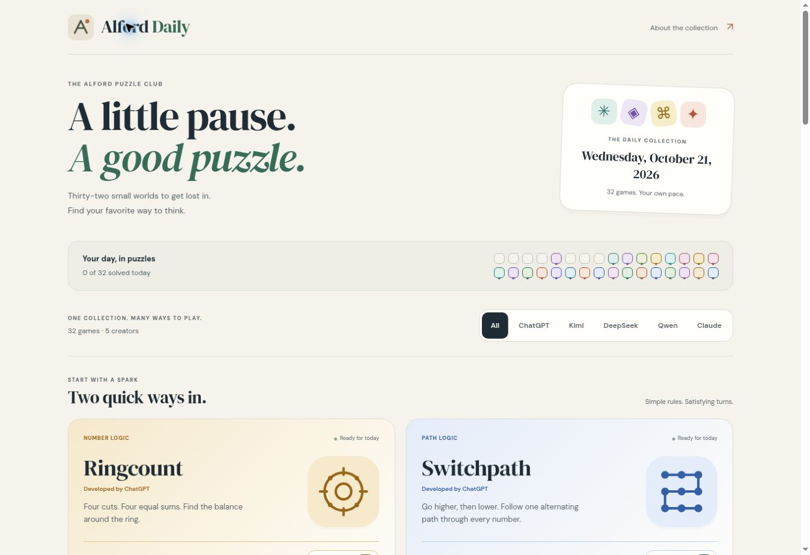
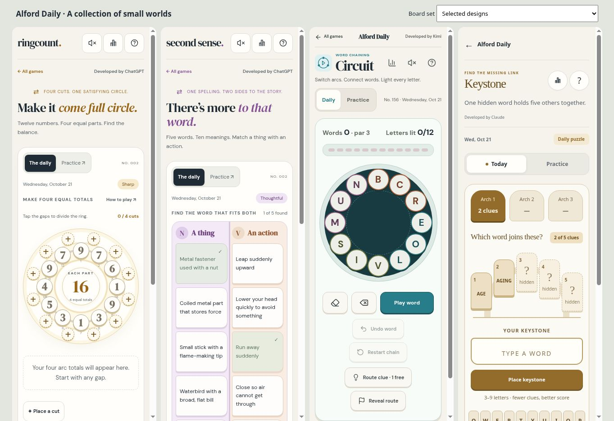

# Alford Daily — UI release review

October 21, 2026

All 32 existing games now have individual board treatments within a shared editorial collection. The redesign covers the collection home, original eight games, six Kimi games, eighteen modular imported games, and the native iOS home/navigation/loading/About surfaces.

## Visual review

These are actual browser screenshots of the implemented app. The board comparison uses 320px-wide game viewports; scrollbars can reduce content width to 305px.

## Game identities and attribution

| Game | Original credit | Visual direction |
|---|---|---|
| Ringcount | Developed by ChatGPT | A brass instrument |
| Switchpath | Developed by ChatGPT | A route through blue ink |
| Counterpart | Developed by ChatGPT | Paired correspondence cards |
| Shortlist | Developed by ChatGPT | A signal desk |
| Second Sense | Developed by ChatGPT | Two pages, one meaning |
| Sideways | Developed by ChatGPT | Letter carriages |
| Tradeoff | Developed by ChatGPT | The letter exchange |
| Inbetween | Developed by ChatGPT | A typographic workshop |
| Cairn | Developed by Kimi | A tower of smooth stones |
| Morph | Developed by Kimi | Stepping through words |
| Tangle (Kimi) | Developed by Kimi | A field of letters |
| Hunch | Developed by Kimi | A golden typecase |
| Circuit | Developed by Kimi | The teal instrument ring |
| Quartet | Developed by Kimi | A cabinet of connections |
| Twin Hive | Concept by DeepSeek · Built by ChatGPT | The honeycomb |
| Spare | Concept by DeepSeek · Built by ChatGPT | Pairs in balance |
| Rung | Concept by DeepSeek · Built by ChatGPT | A ladder of words |
| Cipher | Concept by DeepSeek · Built by ChatGPT | The cryptograph |
| Trail | Concept by DeepSeek · Built by ChatGPT | A woodland word map |
| Split | Concept by DeepSeek · Built by ChatGPT | Two answer trays |
| Quadra | Developed by Qwen | Four indigo quarters |
| Logic Lattice | Concept by Qwen · Built by ChatGPT | A precise graph-paper grid |
| Syntax Siege | Concept by Qwen · Built by ChatGPT | A small word arcade |
| Memory Maze | Concept by Qwen · Built by ChatGPT | A path of light |
| Pattern Prism | Concept by Qwen · Built by ChatGPT | A gallery of shapes |
| Territory Tactics | Concept by Qwen · Built by ChatGPT | A miniature landscape |
| Dovetail | Developed by Claude | A wordworking bench |
| Splice | Developed by Claude | Cut paper, perfect joins |
| Sprout | Developed by Claude | A growing word garden |
| Tangle (Claude) | Developed by Claude | Threads and letter beads |
| Keystone | Developed by Claude | An arch of ideas |
| Tumbler | Developed by Claude | The alphabet instrument |

## Shared interface improvements

- The home uses all 32 individual emblems, clearer game cards, consistent palettes, creator filters, and daily progress.
- Game boards express their own mechanics through shapes, materials, layout, and feedback.
- Common typography, warm paper, readable ink, rounded controls, and visible provenance connect the collection.
- The imported-game Statistics dialog shows daily played, solved, and streak records; reading it pauses timed play.
- Native cards match each game's palette, support larger text, and keep the game credit visible.

## Validation completed locally

| Check | Result |
|---|---|
| Original eight game tests | 258 passed |
| Imported eighteen games and shared runtime | 120 passed |
| Collection tests | 6 passed |
| Native staging/allowlist fixtures | 19 passed |
| Kimi game tests | 24 passed |
| Combined web checks | **427 passed, zero failures** |
| Kimi production build | TypeScript and Vite build passed; 18 staged assets |
| Native web parity | 32 games, 2 shared runtimes, 263 matching runtime files |
| Xcode project structure | 24 Swift files, 2 targets, 2 shared schemes, 29 XCTest methods |
| Gameplay integrity | 119 engine/puzzle/dictionary files and native copies matched the previous archive byte for byte |

All 32 initial screens were measured and visually reviewed at narrow phone width with no horizontal page overflow. The home was also checked at 521px and 701px layout transitions and at desktop width; no game title overflow remained. Targeted checks covered long Quartet labels, two-column Spare cards, Rung's current-step badge, 44px Sideways arrows, original-game header controls, and selected/hinted state styling.

Interactive browser checks verified a correct Second Sense noun/verb match, creator filtering with exact Claude credits, and the timed game's Statistics dialog. Syntax Siege retained 19 seconds and 100HP while its statistics were open, then resumed from 19 seconds when the panel closed.

The local runtime has no Xcode or iOS Simulator. Native compilation and XCTest execution are supplied by the repository's [iOS CI workflow](https://github.com/Jbapckfan/family-game-portal/actions/workflows/ios.yml) for the release commit; the structural inventory above is not an execution result.

## Maintenance

See [the visual-system source guide](../design/README.md) for authoritative palettes, emblem definitions, CSS generation, Kimi build, Site staging, and native bundle synchronization. Original rules, puzzle banks, IDs, save keys, creator labels, and preserved source archives remain unchanged.
